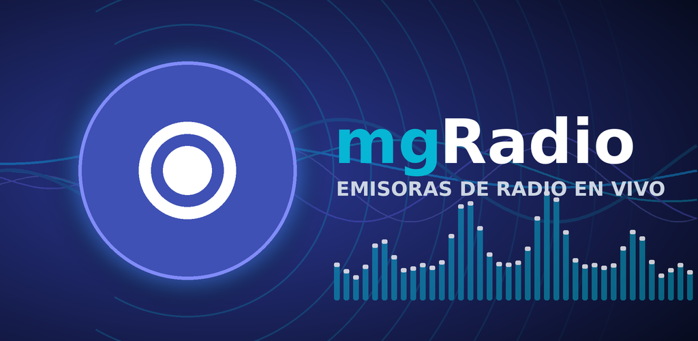
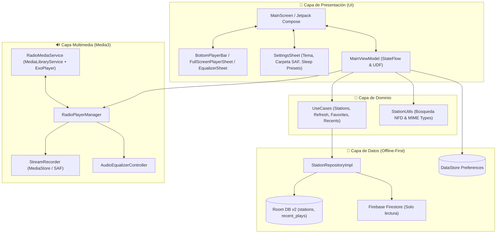

# 📻 mgRadio — Emisoras en Vivo para Android, TV y Auto

<p align="center">
  
</p>

<p align="center">
  <strong>Aplicación nativa de streaming de radio en vivo para Android (Móvil, Android TV y Android Auto) con catálogo Offline-First en Room, cero telemetría y motor de audio AndroidX Media3 (ExoPlayer).</strong>
</p>

<p align="center">
  <a href="#-tecnologías-y-stack"></a>
  <a href="#-tecnologías-y-stack"></a>
  <a href="#-tecnologías-y-stack"></a>
  <a href="#-tecnologías-y-stack"></a>
  <a href="#-tecnologías-y-stack"></a>
  <a href="#-tecnologías-y-stack"></a>
  <a href="#-requisitos-y-entorno"></a>
  <a href="#-requisitos-y-entorno"></a>
  <a href="LICENSE"></a>
</p>

<p align="center">
  
</p>

---

## 📖 Tabla de Contenidos

1. [Visión General](#-visión-general)
2. [Características Principales](#-características-principales)
3. [Arquitectura del Proyecto](#-arquitectura-del-proyecto)
4. [Estructura del Código](#-estructura-del-código)
5. [Tecnologías y Stack](#-tecnologías-y-stack)
6. [Configuración y Puesta en Marcha](#-configuración-y-puesta-en-marcha)
7. [Compilación y Publicación](#-compilación-y-publicación)
8. [Privacidad y Políticas](#-privacidad-y-políticas)
9. [Licencia](#-licencia)

---

## 🌟 Visión General

**mgRadio** (`v2.0.0`) es una aplicación nativa para Android diseñada para ofrecer reproducción de radio en vivo estable, rápida y privada.

- **Catálogo Offline-First:** La interfaz lee siempre desde **Room** (`mgradio_database`), permitiendo arrancar al instante, filtrar, consultar favoritas e historial de recientes incluso sin conexión. **Firebase Firestore** se utiliza únicamente en modo lectura para sincronizar el catálogo curado en segundo plano preservando favoritos locales.
- **Motor Media3 Completo:** Usa `MediaLibraryService` + `ExoPlayer` con soporte para **Android Auto**, metadatos **ICY (*Now Playing*)**, reconexión automática ante cortes de red, ecualizador integrado, grabación directa y temporizador de apagado.
- **Privacidad Total:** Sin `firebase-analytics` ni rastreadores de terceros.

---

## ✨ Características Principales

- 📻 **Streaming Universal:** Soporte para **Icecast**, **Shoutcast** y **HLS (`.m3u8`)** en formatos **AAC, AAC+ y MP3**.
- 🎵 **Metadatos ICY en Vivo (*Now Playing*):** Muestra el título/artista transmitido por la emisora en el mini-reproductor, reproductor completo y notificación multimedia.
- 🔄 **Reconexión Automática:** Reintentos automáticos con *backoff* exponencial (hasta 3 intentos) ante caídas temporales de red.
- 🎙️ **Grabación de Transmisiones:** Graba streams MP3/AAC en `Music/mgRadio` o en cualquier carpeta elegida por SAF (`OpenDocumentTree`) desde **Ajustes**.
- 🎚️ **Ecualizador Integrado:** Control de presets y bandas conectado al `audioSessionId` real de `ExoPlayer`.
- ⏱️ **Sleep Timer Configurable:** Temporizador de apagado con tiempos personalizables desde Ajustes.
- 🔍 **Búsqueda y Filtros Dinámicos:** Búsqueda sin acentos por nombre, frecuencia, categoría o etiquetas (`tags`), filtros persistentes por país/ciudad y contadores dinámicos en pestañas (**Todas**, **Favoritas**, **Recientes**, **Offline**).
- 📺 **Android TV y Control Remoto:** Lanzador Leanback, banner de TV, navegación D-Pad con anillos de foco, soporte de teclas multimedia (`Play/Pause/Stop`) y prevención de suspensión (`FLAG_KEEP_SCREEN_ON`) respetando el Sleep Timer.
- 🚗 **Android Auto:** Árbol navegable vía `MediaLibraryService` (*Favoritas*, *Recientes*, *Todas*).
- 🎨 **Temas Material 3:** **Oscuro AMOLED**, **Claro**, **Sistema** y **Material You** (*Dynamic Color* en Android 12+).

---

## 🏗️ Arquitectura del Proyecto

El proyecto sigue **Clean Architecture** + **MVVM / UDF (Unidirectional Data Flow)**:



---

## 📁 Estructura del Código

```text
app/src/main/java/com/mgradio/app/
├── RadioApplication.kt              # Inicialización de Hilt
├── MainActivity.kt                  # Edge-to-Edge, temas y FLAG_KEEP_SCREEN_ON
├── di/AppModule.kt                  # Room (MIGRATION_1_2), Firestore, DataStore
├── domain/
│   ├── model/Models.kt              # Station, PlayerUiState, EqualizerState, UserPreferences
│   ├── repository/Repositories.kt   # StationRepository, PreferencesRepository
│   ├── usecase/StationUseCases.kt   # Casos de uso de catálogo, favoritos y recientes
│   └── util/StationUtils.kt         # Búsqueda normalizada y detección de MIME types
├── data/
│   ├── local/                       # RadioDatabase, StationDao, DataStorePreferencesRepository
│   ├── remote/                      # FirestoreRemoteDataSource, StationDtoAndMapper
│   └── repository/                  # StationRepositoryImpl (sincronización no destructiva)
├── media/
│   ├── RadioMediaService.kt         # MediaLibraryService (ExoPlayer, ICY, Auto, Reconexión)
│   ├── RadioPlayerManager.kt        # MediaController, volumen, Sleep Timer
│   ├── StreamRecorder.kt            # Grabación HTTP/ICY a MediaStore / SAF
│   ├── AudioEqualizerController.kt  # Control de bandas android.media.audiofx.Equalizer
│   └── PlaybackBridge.kt            # Estado en vivo de audioSessionId, ICY y reconexión
└── presentation/
    ├── main/                        # MainViewModel, MainScreen (Móvil y Android TV)
    ├── player/PlayerSheets.kt       # BottomPlayerBar, FullScreenPlayerSheet, EqualizerSheet, SleepTimerDialog
    ├── settings/SettingsSheet.kt    # Temas, Material You, carpeta de grabaciones, Sleep presets
    └── theme/                       # Color.kt, Theme.kt, Type.kt, TvFocusModifier.kt
```

---

## 🛠️ Tecnologías y Stack

| Categoría | Tecnología / Librería | Detalle |
| :--- | :--- | :--- |
| **Lenguaje** | [Kotlin](https://kotlinlang.org/) | `2.2.10` |
| **UI Framework** | [Jetpack Compose](https://developer.android.com/jetpack/compose) | Material Design 3 (`2024.11.00`) |
| **Inyección de Dependencias** | [Hilt (Dagger-Hilt)](https://dagger.dev/hilt/) | `2.57.1` + KSP `2.3.6` |
| **Base de Datos Local** | [AndroidX Room](https://developer.android.com/training/data-storage/room) | `2.7.0` (`MIGRATION_1_2`) |
| **Preferencias** | [DataStore Preferences](https://developer.android.com/topic/libraries/architecture/datastore) | `1.1.2` |
| **Motor de Audio** | [AndroidX Media3](https://developer.android.com/guide/topics/media/media3) | `1.4.1` (ExoPlayer, HLS, MediaLibraryService) |
| **Catálogo Remoto** | [Firebase Firestore](https://firebase.google.com/docs/firestore) | Solo lectura (sin Firebase Analytics) |
| **Carga de Imágenes** | [Coil Compose](https://coil-kt.github.io/coil/) | `2.7.0` |
| **Publicación Play Store** | [Gradle Play Publisher](https://github.com/Triple-T/gradle-play-publisher) | `3.12.1` |
| **Plataforma SDK** | Android SDK | Min: **26** (8.0) / Target: **36** (16) |

---

## 🚀 Configuración y Puesta en Marcha

### 1. Prerrequisitos
- **Android Studio** (Ladybug o superior)
- **JDK 17**
- Dispositivo físico o emulador con **Android 8.0 (API 26)** o superior

### 2. Clonar y configurar Firebase
```bash
git clone https://github.com/lmsalazae/mgradio-android.git
cd mgradio-android
```
Coloca tu `google-services.json` en `app/google-services.json` (usa `app/google-services.json.example` como referencia).

---

## 📦 Compilación y Publicación

```bash
# Ejecutar pruebas unitarias JVM
./gradlew testDebugUnitTest

# Compilar e instalar en dispositivo/TV conectado por ADB
./gradlew installDebug

# Generar Android App Bundle (.aab) firmado para Google Play
./gradlew bundleRelease

# Subir bundle a Google Play Console (requiere service account JSON configurado)
./gradlew publishReleaseBundle
```

---

## 🔒 Privacidad y Políticas

**mgRadio** está diseñada con **cero telemetría**:
- No recopila analíticas, crash logs remotos ni identificadores de dispositivo.
- Consulta la política de privacidad en formato web en [docs/privacy-policy.html](docs/privacy-policy.html).

---

## 📄 Licencia

Licenciado bajo **GNU General Public License v3.0 (GPLv3)**. Consulta [LICENSE](LICENSE) para más detalles.

---

### 📬 Contacto y Soporte

- ✉️ **Correo:** migcontacto@gmail.com
- 🌐 **Sitio Web:** [https://lmsalazae.github.io/mgradio-android](https://lmsalazae.github.io/mgradio-android)
